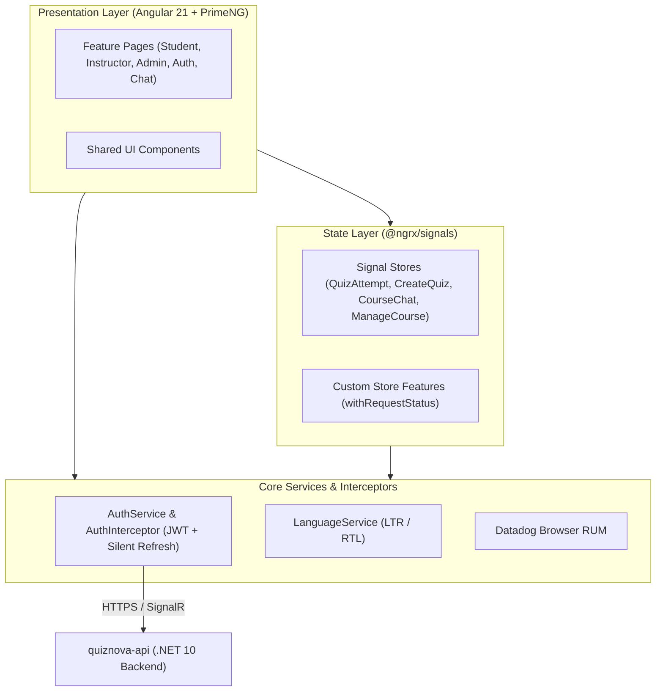
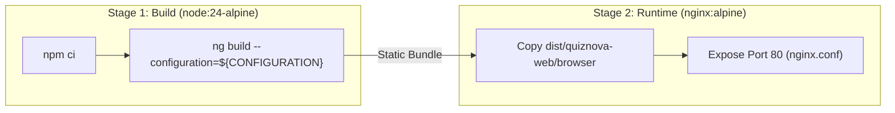

# QuizNova Web

[](https://quiznova.dev)

**Live Application:** [quiznova.dev](https://quiznova.dev) _(Fallback mirror:
[GitHub Pages](https://moamenelbarqy.github.io/quiz-nova/))_

Frontend Single Page Application (SPA) for the **QuizNova** assessment platform,
built by [Moamen Elbarky](https://github.com/moamenelbarky) with **Angular 21**,
**PrimeNG**, and **NgRx Signals**.

> [!NOTE] **Live Demo & Cold-Start Notice:** This application is hosted for
> demonstration and learning purposes. While the frontend is served statically,
> the backend API runs on Azure Container Apps with **scale-to-zero** enabled,
> so the initial request after inactivity may take **10–15 seconds** to
> cold-start. Live demo availability is also subject to monthly free-tier cloud
> credit quotas.

---

## Tech Stack

- **Framework:** Angular 21 (Standalone Components, Signals, Reactive Forms)
- **State Management:** `@ngrx/signals` with custom store features
  (`withRequestStatus`)
- **UI & Styling:** PrimeNG 21, PrimeIcons, CSS Logical Properties (LTR / RTL
  support)
- **Real-Time Communication:** `@microsoft/signalr` (Course Chat)
- **Internationalization:** `@ngx-translate/core` (`public/assets/i18n/`)
- **Observability:** Datadog Browser RUM (`@datadog/browser-rum`)
- **Testing:** Vitest & `@testing-library/angular` (unit), Playwright &
  `@axe-core/playwright` (E2E & accessibility)
- **Containerization & Hosting:** Docker, Nginx, GitHub Pages (Production),
  Azure Container Apps (Dev & Staging Previews)

---

## Architecture Overview

### Frontend Component & State Flow



### Multi-Stage Docker Build & Nginx Runtime



---

## Project Structure

```text
quiznova-web/
├── .github/
│   └── workflows/
│       ├── ci.yml                 # Lint, Unit Test, Coverage & Build Gates
│       ├── deploy-gh-pages.yml    # Production Deployment to GitHub Pages
│       └── deploy-preview.yml     # Dev & Staging Deployment to Azure Container Apps
├── e2e/                           # Playwright E2E and Accessibility tests
├── public/                        # Static assets and i18n translation files
├── src/
│   ├── app/                       # Angular features, core services, and shared UI
│   ├── environments/              # Environment configs (dev, staging, prod)
│   ├── store-features/            # Reusable NgRx Signal Store extensions
│   ├── main.ts                    # Application bootstrap & Datadog RUM init
│   └── styles.css                 # Global styles
├── terraform/                     # Terraform for GitHub Pages, DNS & ACA previews
├── angular.json                   # Angular workspace configuration
├── compose.yaml                   # Local Docker Compose setup
├── Dockerfile                     # Multi-stage build (Node 24 -> Nginx Alpine)
├── nginx.conf                     # Nginx SPA routing, caching & /healthz endpoint
├── package.json                   # Dependencies and scripts
└── vitest.config.ts               # Vitest configuration
```

---

## Getting Started

### Prerequisites

- **Node.js**: `v22.x` or later
- **npm**: `v11.x` or later

### Local Development

```bash
git clone https://github.com/quiz-nova/quiznova-web.git
cd quiznova-web
npm install
npm start
```

Open `http://localhost:4200/` in your browser.

---

## Docker Support

The `Dockerfile` compiles the Angular bundle and serves it via **Nginx** on
container port `80`.

### Run with Docker Compose

```bash
docker compose up --build -d
```

### Build & Run Manually

```bash
docker build -t quiznova-web:latest .
docker run -d --name quiznova-web -p 4200:80 quiznova-web:latest
```

Access the containerized app at `http://localhost:4200`.

---

## Infrastructure & Deployments

- **Production**: Deployed to **GitHub Pages** (`quiznova.dev`) via
  `deploy-gh-pages.yml` on pushes to `main`.
- **Preview Environments**: Pushes to `develop` and `staging` trigger
  `deploy-preview.yml`, building a container image in GHCR and deploying to
  **Azure Container Apps** (`quiznova-web-dev` and `quiznova-web-stg`) using
  passwordless Azure OIDC.
- **Terraform (`terraform/`)**: Manages custom domain DNS, GitHub Pages binding,
  Azure Container Apps preview environments, and OIDC credentials with secrets
  injected via **Doppler**.

---

## Related Repositories & Author

- **Backend API:** [`quiznova-api`](https://github.com/quiz-nova/quiznova-api)
- **Platform Infrastructure:**
  [`quiznova-infra`](https://github.com/quiz-nova/quiznova-infra)
- **Project Wiki & Notes:**
  [`quiznova-api.wiki`](https://github.com/quiz-nova/quiznova-api/wiki)
- **Author:** [Moamen Elbarky](https://github.com/moamenelbarky)
